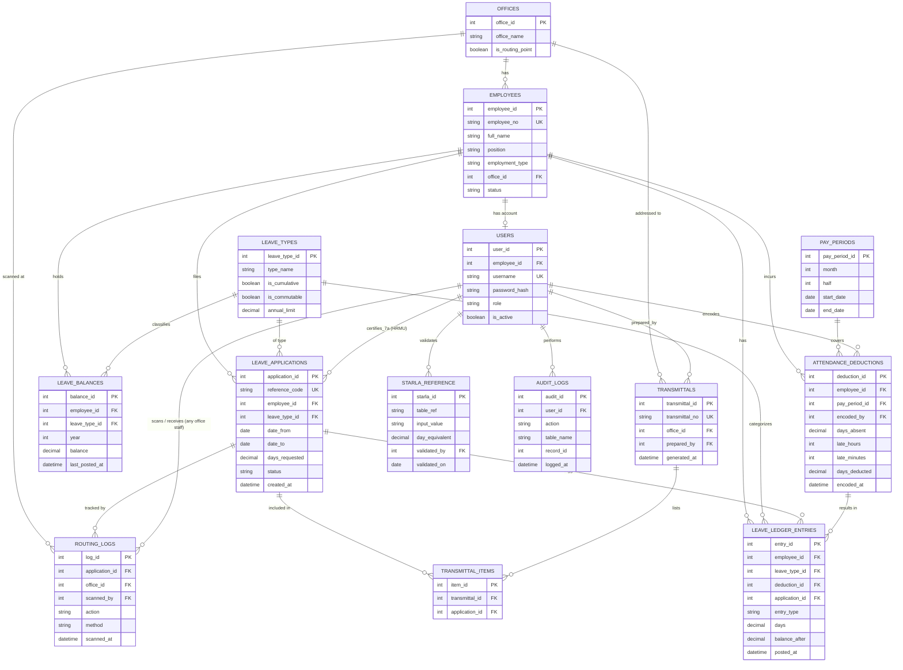

# C-LACTS Database Architecture & Drizzle Schema Specification

> **System:** Centralized Leave Application and Credit Tracking System (C-LACTS)  
> **Agency:** Human Resource Management Unit (HRMU), Municipality of Basud, Camarines Norte  
> **Source of Truth:** Official ERD Diagram validated against IT 116 Project Proposal & Defense Panel Feedback.

---

## 1. Verified Entity Relationship Diagram (ERD)



---

## 2. Production Drizzle ORM Schema (`src/db/schema.ts`)

```typescript
import { pgTable, serial, text, timestamp, date, integer, decimal, boolean } from "drizzle-orm/pg-core";
import { relations } from "drizzle-orm";

// 1. OFFICES / DEPARTMENTS
export const offices = pgTable("offices", {
  officeId: serial("office_id").primaryKey(),
  officeName: text("office_name").notNull(),
  isRoutingPoint: boolean("is_routing_point").default(false).notNull(),
});

// 2. EMPLOYEES (~158 regular employees & elected officials)
export const employees = pgTable("employees", {
  employeeId: serial("employee_id").primaryKey(),
  employeeNo: text("employee_no").notNull().unique(), // e.g., 'BASUD-EMP-001'
  fullName: text("full_name").notNull(),
  position: text("position").notNull(),
  employmentType: text("employment_type").notNull(), // 'Permanent', 'Casual', 'Elected'
  officeId: integer("office_id").references(() => offices.officeId).notNull(),
  status: text("status").default("active").notNull(), // 'active', 'separated', 'retired'
});

// 3. USERS (4-Role RBAC: standard_employee, hr_staff, routing_clerk, system_admin)
export const users = pgTable("users", {
  userId: serial("user_id").primaryKey(),
  employeeId: integer("employee_id").references(() => employees.employeeId),
  username: text("username").notNull().unique(),
  passwordHash: text("password_hash").notNull(),
  role: text("role").notNull(), // 'standard_employee' | 'hr_staff' | 'routing_clerk' | 'system_admin'
  isActive: boolean("is_active").default(true).notNull(),
});

// 4. LEAVE TYPES (VL, SL, Mandatory Forced, SPL, Wellness Leave, etc.)
export const leaveTypes = pgTable("leave_types", {
  leaveTypeId: serial("leave_type_id").primaryKey(),
  typeName: text("type_name").notNull(), // 'Vacation Leave', 'Sick Leave', 'Mandatory Forced Leave', 'Special Privilege Leave', 'Wellness Leave'
  isCumulative: boolean("is_cumulative").default(false).notNull(), // true for VL and SL
  isCommutable: boolean("is_commutable").default(false).notNull(), // true for VL and SL
  annualLimit: decimal("annual_limit", { precision: 5, scale: 2 }), // e.g. 5.0 for Forced, 3.0 for SPL, 5.0 for Wellness
});

// 5. LEAVE BALANCES (Normalized per employee and leave type)
export const leaveBalances = pgTable("leave_balances", {
  balanceId: serial("balance_id").primaryKey(),
  employeeId: integer("employee_id").references(() => employees.employeeId, { onDelete: "cascade" }).notNull(),
  leaveTypeId: integer("leave_type_id").references(() => leaveTypes.leaveTypeId).notNull(),
  year: integer("year").notNull(),
  balance: decimal("balance", { precision: 7, scale: 3 }).default("0.000").notNull(),
  lastPostedAt: timestamp("last_posted_at", { withTimezone: true }).defaultNow().notNull(),
});

// 6. LEAVE APPLICATIONS (CSC Form 6)
export const leaveApplications = pgTable("leave_applications", {
  applicationId: serial("application_id").primaryKey(),
  referenceCode: text("reference_code").notNull().unique(), // e.g. 'LA-2026-000123'
  employeeId: integer("employee_id").references(() => employees.employeeId).notNull(),
  leaveTypeId: integer("leave_type_id").references(() => leaveTypes.leaveTypeId).notNull(),
  dateFrom: date("date_from").notNull(),
  dateTo: date("date_to").notNull(),
  daysRequested: decimal("days_requested", { precision: 5, scale: 2 }).notNull(),
  status: text("status").default("draft").notNull(), // 'draft', 'routed', 'received_dept', 'received_hrmu', 'received_mayor', 'approved', 'disapproved', 'cancelled'
  createdAt: timestamp("created_at", { withTimezone: true }).defaultNow().notNull(),
});

// 7. ROUTING LOGS (QR Scans & Document Hand-offs — Scannable by Any Authenticated Office Staff on Duty)
export const routingLogs = pgTable("routing_logs", {
  logId: serial("log_id").primaryKey(),
  applicationId: integer("application_id").references(() => leaveApplications.applicationId, { onDelete: "cascade" }).notNull(),
  officeId: integer("office_id").references(() => offices.officeId).notNull(), // Receiving/Dispatching Office Station
  scannedBy: integer("scanned_by").references(() => users.userId).notNull(), // Any authenticated personnel on duty in that office who received/dispatched the paper
  action: text("action").notNull(), // 'RECEIVED', 'DISPATCHED', 'RECOMMENDED', 'RECOMMENDED_DISAPPROVAL', 'APPROVED_PHYSICAL', 'DISAPPROVED_PHYSICAL'
  method: text("method").notNull(), // 'QR_SCAN' | 'MANUAL_ENTRY'
  scannedAt: timestamp("scanned_at", { withTimezone: true }).defaultNow().notNull(),
});

// 8. TRANSMITTALS (Batch Document Forwarding)
export const transmittals = pgTable("transmittals", {
  transmittalId: serial("transmittal_id").primaryKey(),
  transmittalNo: text("transmittal_no").notNull().unique(), // e.g., 'TR-2026-11-001'
  officeId: integer("office_id").references(() => offices.officeId).notNull(),
  preparedBy: integer("prepared_by").references(() => users.userId).notNull(),
  generatedAt: timestamp("generated_at", { withTimezone: true }).defaultNow().notNull(),
});

// 9. TRANSMITTAL ITEMS (Junction Table)
export const transmittalItems = pgTable("transmittal_items", {
  itemId: serial("item_id").primaryKey(),
  transmittalId: integer("transmittal_id").references(() => transmittals.transmittalId, { onDelete: "cascade" }).notNull(),
  applicationId: integer("application_id").references(() => leaveApplications.applicationId).notNull(),
});

// 10. PAY PERIODS (Semi-Monthly Cut-offs)
export const payPeriods = pgTable("pay_periods", {
  payPeriodId: serial("pay_period_id").primaryKey(),
  month: integer("month").notNull(),
  half: integer("half").notNull(), // 1 for 1st-15th, 2 for 16th-end
  startDate: date("start_date").notNull(),
  endDate: date("end_date").notNull(),
});

// 11. ATTENDANCE DEDUCTIONS (Semi-Monthly Summary Encoded by HR)
export const attendanceDeductions = pgTable("attendance_deductions", {
  deductionId: serial("deduction_id").primaryKey(),
  employeeId: integer("employee_id").references(() => employees.employeeId).notNull(),
  payPeriodId: integer("pay_period_id").references(() => payPeriods.payPeriodId).notNull(),
  encodedBy: integer("encoded_by").references(() => users.userId).notNull(),
  daysAbsent: decimal("days_absent", { precision: 4, scale: 2 }).default("0.00").notNull(),
  lateHours: integer("late_hours").default(0).notNull(),
  lateMinutes: integer("late_minutes").default(0).notNull(),
  daysDeducted: decimal("days_deducted", { precision: 6, scale: 3 }).default("0.000").notNull(),
  encodedAt: timestamp("encoded_at", { withTimezone: true }).defaultNow().notNull(),
});

// 12. LEAVE LEDGER ENTRIES (Comprehensive Audit Trail & Running Balances)
export const leaveLedgerEntries = pgTable("leave_ledger_entries", {
  entryId: serial("entry_id").primaryKey(),
  employeeId: integer("employee_id").references(() => employees.employeeId).notNull(),
  leaveTypeId: integer("leave_type_id").references(() => leaveTypes.leaveTypeId).notNull(),
  deductionId: integer("deduction_id").references(() => attendanceDeductions.deductionId),
  applicationId: integer("application_id").references(() => leaveApplications.applicationId),
  entryType: text("entry_type").notNull(), // 'MONTHLY_ACCRUAL', 'TARDINESS_DEDUCTION', 'ABSENCE_DEDUCTION', 'LEAVE_AVAILED', 'OPENING_BALANCE'
  days: decimal("days", { precision: 6, scale: 3 }).notNull(),
  balanceAfter: decimal("balance_after", { precision: 7, scale: 3 }).notNull(),
  postedAt: timestamp("posted_at", { withTimezone: true }).defaultNow().notNull(),
});

// 13. STARLA REFERENCE (Digitized CSC Conversion Matrix)
export const starlaReference = pgTable("starla_reference", {
  starlaId: serial("starla_id").primaryKey(),
  tableRef: text("table_ref").notNull(), // 'Table II', 'Table III', 'Table IV'
  inputValue: text("input_value").notNull(), // e.g. '15 mins', '4 hrs', '15 days'
  dayEquivalent: decimal("day_equivalent", { precision: 6, scale: 3 }).notNull(), // e.g. 0.031, 0.500, 0.625
  validatedBy: integer("validated_by").references(() => users.userId),
  validatedOn: date("validated_on"),
});

// 14. AUDIT LOGS (Security & Compliance)
export const auditLogs = pgTable("audit_logs", {
  auditId: serial("audit_id").primaryKey(),
  userId: integer("user_id").references(() => users.userId),
  action: text("action").notNull(),
  tableName: text("table_name").notNull(),
  recordId: integer("record_id").notNull(),
  loggedAt: timestamp("logged_at", { withTimezone: true }).defaultNow().notNull(),
});
```
