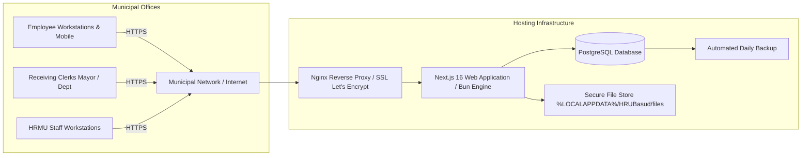

# Deployment Architecture & Revised Implementation Schedule

> **Document Class:** Infrastructure Design & Project Timeline  
> **Course Requirement:** IT 116: System Analysis and Design  
> **Key Objective:** Address professor's directive requiring a working, deployed system, user training, and live pilot execution **before** the December final defense.

---

## 1. Approved Deployment Architecture

To guarantee high availability, strict security, and zero disruption during municipal office hours, the system will use a dual-tier deployment strategy:

### 1.1 Infrastructure Specifications
- **Primary Hosting Platform:** Cloud Virtual Private Server (Cloud VPS - Ubuntu LTS / 4GB RAM / 2 vCPU / SSD) as authorized in the proposal's cost-benefit fallback plan (or DICT GWHS if municipal memorandum is finalized).
- **Reverse Proxy & Security:** Nginx with HTTP/2, automated TLS/SSL encryption certificates (Let's Encrypt), rate limiting on authentication routes, and strict CORS.
- **Database Engine:** Managed PostgreSQL database with automated daily snapshots and WAL archiving.
- **Local Network Accessibility:** Resolvable via custom municipal subdomain or dedicated IP reachable from municipal desktop workstations and mobile browsers across all offices (HRMU, Mayor's Office, Department Offices).

---

## 2. Clarification & Revision of the Implementation Schedule

### 2.1 The Issue Raised by Professor
The original proposal timeline contained a potential ambiguity where the live pilot or final evaluation was scheduled in parallel with or after the final defense. However, **IT 116 course policy strictly mandates that the system must be fully working, deployed in its target environment, and evaluated with actual users BEFORE the final defense.**

### 2.2 Revised 8-Week Milestone Schedule

The implementation timeline is revised as follows to guarantee that deployment, user training, and the live pilot are completed prior to the December final defense:

| Week | Inclusive Dates | Milestones & Activities | Status / Deliverables |
|---|---|---|---|
| **W1** | Oct 19 – Oct 25 | Topic and beneficiary validation, initial HRMU interviews | ✅ Completed |
| **W2** | Oct 26 – Nov 1 | Proposal writing, requirements modeling, secondary preliminary defense preparation | 🔄 In Progress |
| **W3** | Nov 2 – Nov 8 | **Secondary Preliminary Defense**; Finalize Starla table schemas (Tables II, III, IV) and 158-employee migration template | 📅 Scheduled |
| **W4** | Nov 9 – Nov 15 | **Development Sprint 1:** Starla computation backend, digital leave ledger, 4-role RBAC; **Data Migration:** Baseline encoding & HR verification of 158 employees | 📅 Scheduled |
| **W5** | Nov 16 – Nov 22 | **Development Sprint 2:** Pre-filled CSC Form 6 generation with QR code, receiving clerk QR tracking interface, transmittal letters, and leave reports | 📅 Scheduled |
| **W6** | Nov 23 – Nov 29 | **System Integration & Live Deployment:** Deploy to Cloud VPS environment, configure domain/SSL, verify municipal network accessibility; conduct internal functional testing | 📅 Scheduled |
| **W7** | Nov 30 – Dec 6 | **LIVE PILOT & USER TRAINING (Pre-Defense):**  • Conduct role-specific training for HRMU staff, receiving clerks, and sample employees on the live deployed system. • Execute 1-week live parallel pilot: encode sample DTR cut-off, route live leave applications with QR tracking. • Administer ISO/IEC 25010:2023 evaluation survey. • Immediate bug-fixing and minor revisions. | 📅 Scheduled |
| **W8** | Dec 7 – Dec 13 | **FINAL DEFENSE:**  • Demonstrate live, deployed system with 158 validated employee records. • Present empirical results from Week 7 live pilot and ISO 25010 user evaluation scores. • Submit finalized user manuals and post-defense documentation. | 🎯 Final Goal |

---

## 3. Pre-Defense Live Pilot Plan (Week 7)

To satisfy the professor's requirement, the live pilot in Week 7 will execute the following concrete test scenarios with HRMU personnel:

1. **Semi-Monthly Attendance Posting:** HRMU staff encode actual tardiness and unexcused absence totals for a sample department, verifying that the system calculates exact fractional deductions matching the manual "Starla" folder.
2. **End-to-End Leave Application:** A test employee files a 3-day vacation leave on the dashboard. The system prints a pre-filled CSC Form 6 with QR code.
3. **Physical Routing Simulation:**
   - Receiving clerk at Department Office scans QR -> marked "Received at Dept Office".
   - Forwarded to HRMU -> HR staff scans QR -> certifies balance.
   - Forwarded to Mayor's Office -> Mayor's clerk scans QR -> marked "Received at Mayor's Office".
   - Returned to HRMU -> HR staff scans QR -> final action posted; system automatically debits 3.0 days from the employee's ledger.
4. **Evaluation Gathering:** Collect signed ISO/IEC 25010:2023 survey questionnaires from participants to present during the final defense.
