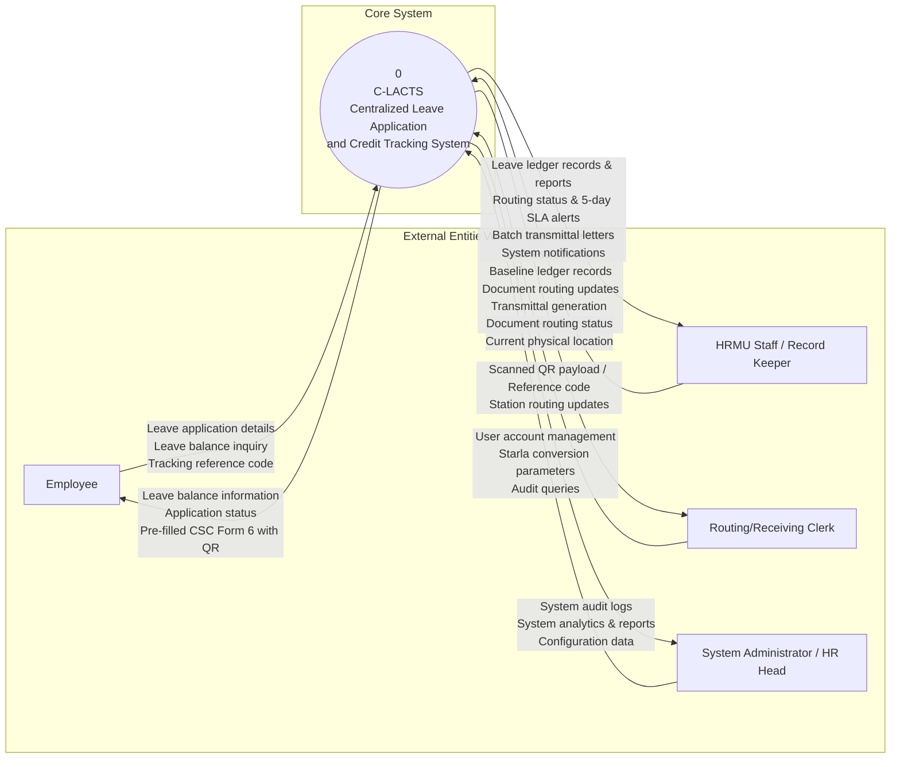

# C-LACTS Context Diagram (DFD Level 0)

> **Document Class:** System Analysis & Design Specification  
> **Course:** IT 116: System Analysis and Design  
> **Source of Truth:** Level 0 DFD submitted for Secondary Defense, aligned with approved Project Proposal & 4-Role RBAC.

---

## 1. Context Diagram Overview

The Level 0 Context Diagram establishes the operational boundary of the **Centralized Leave Application and Credit Tracking System (C-LACTS)**. It models all information exchanged between the system (Process 0) and the four external entities corresponding to the system's four authorized user roles.

---

## 2. External Entity & Data Flow Mapping

### 2.1 Employee (View & Track Level)
*Scope: Approximately 158 regular employees and elected officials.*
- **Inflows to C-LACTS:**
  - `Leave application details`: Leave type, inclusive dates, working days applied for, commutation flag.
  - `Leave balance inquiry`: Request to inspect certified VL, SL, FL, SPL, and Wellness Leave balances.
  - `Tracking reference code`: Alphanumeric reference code (e.g. `LA-2026-000123`) to check physical routing status.
- **Outflows to Employee:**
  - `Leave balance information`: Certified balances as of the latest HR-posted deduction.
  - `Application status`: Real-time physical location and routing history.
  - `Generated forms`: Printable pre-filled CSC Form 6 (Revised 2020) with embedded QR code.

### 2.2 HRMU Staff / Record Keeper (Processing Level)
*Scope: HR personnel responsible for leave ledgers and DTR deduction verification.*
- **Inflows to C-LACTS:**
  - `Verified attendance totals`: Semi-monthly late hours, late minutes, and unexcused absences verified from physical DTRs.
  - `Baseline ledger records`: Initial cardstock balances for the 158-employee migration.
  - `Document routing updates`: Scans and status changes at the HRMU station (e.g. "Certified at HRMU", "Final Action Posted").
  - `Transmittal generation request`: Batch selection of leave forms for forwarding to the Mayor's Office.
- **Outflows to HRMU Staff:**
  - `Leave ledger records and reports`: Digital leave card transaction history, cumulative balances, employee summary sheets.
  - `Batch transmittal letters`: Printable transmittal manifests listing applications forwarded to other offices.
  - `Routing status & 5-day SLA alerts`: Notifications tracking applications nearing the 5-working-day deemed approval rule.

### 2.3 Routing/Receiving Clerk (Status Updater Level — Functional Role)
*Scope: Any authenticated personnel on duty at Department Offices, HRMU, and the Mayor's Office acting as document receiver/dispatcher.*
- **Inflows to C-LACTS:**
  - `Scanned QR payload / Reference code`: Scanned via webcam/scanner or manually entered by whichever office staff member receives the physical form.
  - `Station routing updates`: Action taken (`RECEIVED`, `DISPATCHED`, `RECOMMENDED`, `APPROVED_PHYSICAL`, `DISAPPROVED_PHYSICAL`), station `office_id`, and receiving staff's `user_id` (`scanned_by`).
- **Outflows to Routing Clerk:**
  - `Document routing status`: Confirmation of recorded status, current location, and hand-off timestamp.

### 2.4 System Administrator / HR Head (Configuration Level)
*Scope: Full audit trail oversight and regulatory table maintenance.*
- **Inflows to C-LACTS:**
  - `User account management`: Creation and role assignment for system accounts.
  - `Starla conversion parameters`: Adjustments to backend conversion matrices should CSC regulations change.
  - `Audit queries`: Filter parameters for security and data change audits.
- **Outflows to System Administrator:**
  - `System audit logs`: Audit trail transaction logs with SHA-256 integrity hashes.
  - `System reports`: Administrative summaries, active user statistics, and compliance metrics.
  - `Configuration data`: Active Starla lookup values and system configuration profiles.

---

## 3. Academic Defense Polish Checklist (IT 116)

1. **Typographical Corrections:**
   - Change `"Routing/Relceiving Clerk"` $\rightarrow$ **`"Routing/Receiving Clerk"`** (remove the extra 'l').
   - Change `"Leave appliation details"` $\rightarrow$ **`"Leave application details"`** (add the missing 'c').
2. **DFD Naming Conventions (Data Nouns vs Verbs):**
   - Replace action/verb phrases like `"View leave balance"` with noun data phrases like **`"Leave balance inquiry"`** or **`"Account inquiry"`**.
   - Replace `"Track application status"` with **`"Tracking inquiry / Reference code"`**.
3. **Defense Question Anticipation:**
   - *Question:* "Why are the Mayor and Department Heads not listed as external entities?"
   - *Answer:* Under Basud municipal policy, physical wet signatures are retained on the paper form. The software tracks physical document movement exclusively through stationed **Routing/Receiving Clerks** and HR staff who scan/enter the QR code, matching the 4-role RBAC defined in the proposal.
