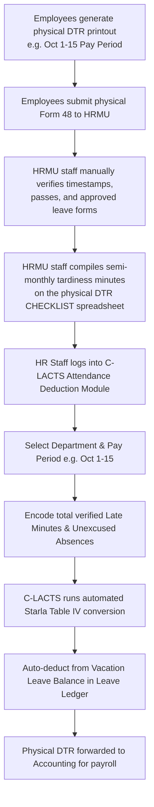

# DTR Checklist & Attendance Deduction Encoding Workflow

> **Document Class:** Operational Workflow & Verification Protocol  
> **Agency:** Human Resource Management Unit (HRMU), Municipality of Basud  
> **Primary Sources:** Scanned physical **`DTR CHECKLIST`** spreadsheet and individual semi-monthly time record sheet (`ShalieMar DeVera`, ID 144) from HRMU Basud.

---

## 1. Real-World Municipal DTR Workflow

---

## 2. Municipal Department Structure (Derived from Actual HRMU Checklist)

The physical `DTR CHECKLIST` validates the municipal departmental structure of Basud for the ~158 personnel:

| Dept Code | Official Department Name | Sample Personnel (from HRMU Checklist) |
|---|---|---|
| **HRMO / HRMU** | Human Resource Management Office / Unit | Eugene Sta. Clara, Clayton Sarionga, Vicky Alvaro |
| **LIBRARY** | Municipal Library | Arlene Joy Rodriguez |
| **GSO** | General Services Office | ShalieMar DeVera (ID 144), Cherry Asis |
| **MENRO** | Municipal Environment & Natural Resources Office | Joberlle Navarro |
| **SLAUGHTER** | Municipal Slaughterhouse | Wilson Gutierrez Jr. |
| **MLO** | Municipal Legal / Licensing Office | Loren Bea Tulalian |
| **MCDO** | Municipal Cooperative Development Office | Marte Olaguera, Joy Jarito |
| **MPDO** | Municipal Planning & Development Office | Marjory Santillan, Shirley Guartero, Joy Almadrones |
| **MCR** | Municipal Civil Registrar | Amilo Barrameda, Lorna Sta. Clara, Leadie Medrano |
| **MTO** | Municipal Treasury Office | Neil Angeline Barrameda, Tammy Obias, Domenica Dyplangco |
| **MASSO** | Municipal Assessor's Office | Eleanor Alferes, Susan Mancenido, Jonathan Arciga |
| **AGRICULTURE**| Municipal Agriculture Office | Joshua Mebeza, Angelica Canarla, Jan Ryan Babagay |
| **MDRRMO** | Municipal Disaster Risk Reduction & Management | Verified unit staff |
| **MAYOR** | Office of the Municipal Mayor | Executive staff & clerks |
| **RHU** | Rural Health Unit | Medical & health personnel |
| **SB** | Sangguniang Bayan / Vice Mayor | Legislative support staff |

---

## 3. C-LACTS Data Entry Interface Requirements

### Why C-LACTS does not ingest raw biometric logs:
As shown in the individual DTR sample (`ShalieMar DeVera`, Oct 1–15, 2026), biometric printouts often contain irregularities such as `Missing IN` or `Missing OUT`. HR staff must manually cross-reference these with physical Pass Slips, Official Business (OB) slips, or supervisor excuses **before** determining whether the employee was actually tardy or absent.

### The Fast-Encoding UI in C-LACTS:
1. **Department Filter:** HR staff selects their active department from the dropdown (e.g. `GSO`).
2. **Pay Period Selection:** Selects `Month: October`, `Period: 1st Half (Oct 1 - Oct 15)`.
3. **Tabular Fast-Entry Grid:** The system presents a table pre-filled with the department's active personnel, matching the physical `DTR CHECKLIST`:
   | Employee Name | Position | Verified Late (Mins) | Unexcused Absences (Days) | Starla Deduction (Days) | Status |
   |---|---|:---:|:---:|:---:|:---:|
   | ShalieMar DeVera | Admin Aide | `[ 152 ]` | `[ 0.0 ]` | $0.317\text{ days}$ | 🟢 Converted |
   | Cherry Asis | Utility Worker | `[ 19 ]` | `[ 0.0 ]` | $0.040\text{ days}$ | 🟢 Converted |
4. **1-Click "Compute & Post to Ledgers":**
   - Automatically breaks down late minutes into hours and minutes.
   - Looks up Table IV values: e.g. $152\text{ mins} = 2\text{ hrs (0.250)} + 32\text{ mins (0.067)} = 0.317\text{ days}$.
   - Immediately checks whether the employee has approved leave covering those dates (guaranteeing no double deduction).
   - Posts debit entries into each employee's Leave Record ledger.
