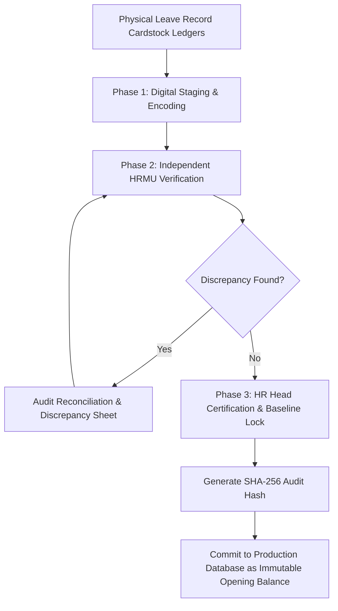

# 158-Employee Data Migration & Validation Plan

> **Document Class:** Data Migration Protocol & Quality Assurance Plan  
> **Target Scope:** Approximately 158 Regular Employees and Elected Officials of the Municipality of Basud, Camarines Norte  
> **Source Records:** Physical cardstock "Leave Record" ledger cards filed at HRMU.

---

## 1. Migration Objective

To establish a verified digital baseline for the leave credit balances of approximately 158 personnel, ensuring that automated "Starla" computations build upon an audited source of truth.

---

## 2. Target Data Schema & Import Structure

A standardized migration workbook (CSV / Excel) will be prepared with the following schema:

| Column Name | Type | Description / Constraints |
|---|---|---|
| `employee_number` | String | Unique municipal employee ID (e.g., `BASUD-EMP-001`) |
| `last_name` | String | Employee surname |
| `first_name` | String | Employee first name |
| `middle_name` | String | Middle name or initial (optional) |
| `department_name` | String | LGU Department (e.g., Mayor's Office, MPDO, MTO, RHU) |
| `position_title` | String | Official plantilla position title |
| `employment_status` | String | `Permanent` / `Casual` / `Elected` |
| `date_hired` | Date (YYYY-MM-DD) | Date of original appointment |
| `baseline_date` | Date (YYYY-MM-DD) | Cut-off date of certified balance (e.g., `2026-10-31`) |
| `vacation_leave_balance` | Decimal(7,3) | Certified VL balance in days (from ledger card) |
| `sick_leave_balance` | Decimal(7,3) | Certified SL balance in days (from ledger card) |
| `forced_leave_balance` | Decimal(4,1) | Remaining mandatory forced leave for current year |
| `spl_balance` | Decimal(4,1) | Remaining Special Privilege Leave (max 3 days) |
| `wellness_leave_balance` | Decimal(4,1) | Remaining Wellness Leave (max 5 days) |
| `certified_by` | String | Name of HRMU Officer certifying the balance |
| `remarks` | String | Notes on historical adjustments or pending actions |

---

## 3. Three-Tier Validation Protocol ("4-Eyes Principle")

### Phase 1: Digital Staging & Encoding
- Proponents and assigned HR encoder transcribe the current balances from the physical card into the staging schema.
- Automated format checks: verify non-negative numbers, validate decimal precision against Starla increments (multiples of 0.042 / 0.125 / etc.), and check required fields.

### Phase 2: Independent HRMU Verification
- HRMU Record Keeper independently cross-checks the staged digital record against the physical ledger card.
- The verifier validates:
  1. Last posted deduction date.
  2. Mathematical sum of historical credit entries.
  3. Proper deduction of mandatory forced leave and special privileges.

### Phase 3: HR Head Certification & Baseline Lock
- Once verified, the HR Head reviews the reconciliation summary and digitally authorizes the baseline import.
- The system generates an immutable opening balance ledger transaction with:
  - `transaction_type = 'OPENING_BALANCE'`
  - `status = 'CERTIFIED'`
  - `created_at = current_timestamp`
  - `audit_hash = SHA-256(employee_number + VL + SL + timestamp)`
- Baseline balances cannot be modified without a formal Administrative Override logged in the System Audit Trail.

---

## 4. Discrepancy Handling & Error Resolution

Historical physical ledger cards frequently contain arithmetic errors or unrecorded deductions due to manual calculator use. When a mismatch is identified:
1. **Flag as Pending Reconciliation:** The record is marked with status `FLAGGED_DISCREPANCY` and excluded from bulk import.
2. **Reconciliation Sheet:** A standardized discrepancy slip is generated stating:
   - Physical card balance vs. recalculation based on verified DTR entries.
   - Identified cause (e.g., calculator rounding error, unposted pass slip).
3. **Official HRMU Resolution:** The HR Officer indicates the accepted official balance and signs the reconciliation sheet.
4. **Encoding with Audit Note:** The agreed balance is encoded into the system with the reconciliation slip attached to the digital record.

---

## 5. Verification Deliverables for Secondary Defense

1. **Populated Migration Master Sheet:** Sample batch of certified records ready for inspection.
2. **Reconciliation Log:** Sample cases demonstrating how historical arithmetic errors were identified and resolved.
3. **Database Seed Script:** Drizzle ORM seed script pre-loading the 158 baseline accounts.
