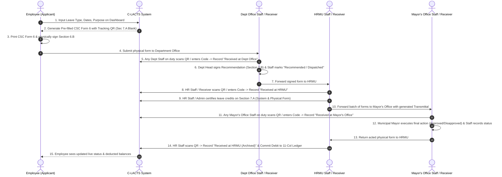

# Leave Application Workflow & QR-Based Physical Routing

> **Document Class:** Functional Specification & Routing Protocol  
> **Applicable Policies:** CSC Form 6 (Revised 2020), CSC MC No. 41, s. 1998 Section 49 (5-day action rule), R.A. 8792 (E-Commerce Act), R.A. 10173 (Data Privacy Act).

---

## 1. Overview & Operational Boundary

The Municipality of Basud maintains a municipal policy mandating **physical paper signatures** on Civil Service Form No. 6 (Application for Leave). The C-LACTS system adheres strictly to this requirement:
- It **does not replace physical signing** with digital signatures.
- It **bridges the physical-digital gap** by pre-filling the form, attaching a secure **tracking QR code and alphanumeric reference code**, and tracking the physical document's hand-offs in real time through quick scans by receiving clerks.

---

## 2. Complete Leave Application Life Cycle

---

## 3. Pre-filled CSC Form 6 Generation

When an employee submits an application on their self-service portal:
1. **Header & Agency Information:** Auto-populated with `Municipality of Basud, Camarines Norte`.
2. **Personal Data:** Auto-populated from the Employee Master (Full Name, Date of Filing, Position, Salary/SG, Office/Department).
3. **Leave Details (Box 6):**
   - Type of Leave (Vacation, Mandatory Forced, Sick, Maternity, Paternity, Special Privilege, Solo Parent, Wellness, etc.).
   - Working days applied for and inclusive dates.
   - Commutation request (Requested / Not Requested).
4. **Certified Leave Credits Box (Box 7.A):**
   - System automatically prints certified balances as of the filing date:
     - Total Vacation Leave credits
     - Less: This application
     - Total Sick Leave credits
     - Less: This application
     - Remaining balances
5. **Embedded Tracking QR & Alphanumeric Code:**
   - **QR Code Content:** Simple URL or secure reference token: `https://hru-basud.local/track/LA-2026-000123` or plain reference `LA-2026-000123`.
   - **Privacy Compliance (R.A. 10173):** In compliance with the proportionality principle, the QR code contains **no confidential medical details or personal contact numbers**. Scanning it displays only the tracking timeline and public metadata.
   - **Alphanumeric Code:** Printed clearly beneath the QR code (e.g., `REF: LA-2026-000123`) to support manual typing when a webcam or scanner is unavailable.

---

## 4. Receiving Clerk & Status Updater Interface

Accessible to any authorized personnel on duty at:
- Department Offices (any Department Office staff acting as Receiving Clerk)
- HRMU Office (HR Staff or receiving personnel)
- Municipal Mayor's Office (any Mayor's Office staff acting as Receiving Clerk)

*(Operational Note: Because receiving physical papers in an LGU office is a shared front-desk duty rather than assigned to a single person, any authenticated personnel in the office can log in or select their name as the receiving operator on the QR Document Scanner terminal. The system logs both the station `office_id` and the exact person `scanned_by` who received or dispatched the form, while restricting Section 7.A credit certification exclusively to `hrmu_staff` and `admin`.)*

### 4.1 Simple Scan / Update Screen
The interface is designed for rapid, 1-click execution:
- **Scan / Input Field:** Auto-focuses on load. Clerk scans with USB handheld barcode/QR scanner, laptop webcam, mobile phone camera, or types the reference code.
- **Action Buttons:**
  - `[ Mark as Received ]` (Records timestamp, clerk username, and current office).
  - `[ Dispatch / Forward to Next Office ]` (Select destination: e.g. "Transmitted to Mayor's Office").
  - `[ Record Action ]` (For HRMU upon return: "Approved by Mayor" / "Disapproved by Mayor").
- **Optional Remarks:** Text field for brief notes (e.g., "Batch Transmittal #104").

---

## 5. 5-Working-Day Statutory SLA Monitoring

Under **Section 49 of CSC Rule XVI (CSC MC No. 41, s. 1998)**:
> *"An application for leave shall be acted upon by the head of agency or authorized representative within five (5) working days after receipt thereof. If not acted upon within said period, the application shall be deemed approved."*

### System SLA Tracker:
- Measures business days elapsed since the document was marked "Received" at any station without action.
- Status indicators:
  - 🟢 **Normal:** 1 - 2 business days.
  - 🟡 **Pending Alert:** 3 - 4 business days (visual amber badge on dashboard).
  - 🔴 **Overdue / Deemed Approved Threshold:** 5+ business days (flagged on HR Executive dashboard for immediate attention).

---

## 6. Batch Transmittal Generation

To prevent documents from getting lost when routed in groups:
- HR staff can select multiple verified leave applications and click **"Generate Transmittal Letter"**.
- Produces a printable transmittal manifest listing:
  - Transmittal Number (e.g., `TR-2026-11-004`)
  - Date and Target Office (e.g., "Office of the Municipal Mayor")
  - Itemized table of employee names, leave types, dates, and application reference codes
  - Signature block for receiving personnel.
